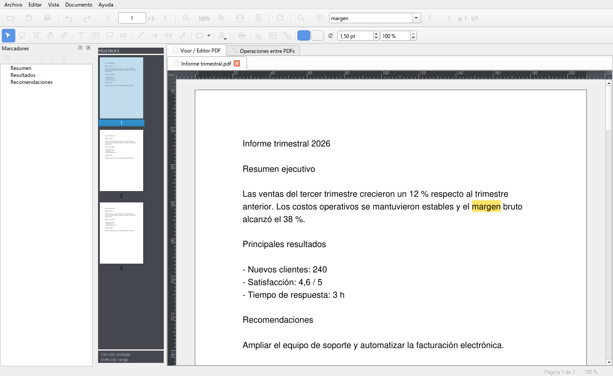

# PDFRapid — free, offline PDF editor

[Español](README.md) · License **AGPL-3.0-or-later** · Windows 10/11 · Python 3.12 + PyQt6 + PyMuPDF

PDFRapid is a free alternative to Acrobat and Foxit for viewing, annotating, editing, signing and organizing PDFs.
It works **100 % offline**: no data is sent, no telemetry, no cloud AI. The only network use, optional and off
by default, is requesting a timestamp when signing.



## Features

**View and read**
- Tabs, thumbnails, editable bookmarks, links, Back/Forward, full screen, night mode.
- Continuous, two-page or two-page-with-cover layout; zoom, rulers in mm/cm/inches and guides with snapping
  to guides and objects; **measure distance, perimeter and area**, also at a drawing scale (1 cm = 1 m).
- **Read aloud** with the Windows voices, offline (page, to the end or selection).
- Arrange objects: align and distribute, flip, group, lock, hide, copy format and exact position and
  size in millimetres.
- Quick find (one match per key press, fast on documents with thousands of pages), advanced search with a
  result list and **folder search** with CSV export.

**Annotate and edit**
- Text, boxes, comments, shapes, arrows, pencil, stamps, highlight/underline/strike-out (and removing them).
- **Spell checking** as you type text and comments (Windows spell checker, with suggestions).
- Edit the PDF's original text, insert and crop images, object formatting, undo/redo.
- **Document images**: right-click one → convert it into an object (move, resize, crop), replace it,
  save it (PNG/JPEG) or delete it.
- **Fill & Sign** (J): ✓, ✗, dot, line, today's date and initials with one click.
- **Forms**: fill them in, create and edit them (text, multi-line, check boxes, grouped radio buttons,
  lists) with name, tooltip, default value, required and read-only; clear the form; **detect fields
  automatically** (lines, underscores, check boxes and empty boxes).
- Attach files, flatten annotations and forms; create and edit links.
- Comments with threaded replies and review status (accepted, rejected…), also visible in Acrobat.

**Document**
- Merge, split, move, extract, rotate, crop and insert pages ("PDF operations" tab).
- Watermark, header and footer with free text, page numbering and Bates, page background, compress, password protection (AES-256), redaction, remove hidden
  information, compare two versions.
- PAdES **digital signature** with a certificate file (.p12/.pfx), a **USB token / smart card** (PKCS#11) or a
  **certificate installed in Windows**; visible QR-code stamp (adjustable size) placed with the mouse, optional
  timestamp (RFC 3161), signature verification and a **QR magnifier** to read a signature's QR code.

**Convert**
- Create PDFs from Word, Excel, PowerPoint (with Microsoft Office or LibreOffice; .docx also without them),
  images or a scanner (the manufacturer's window via TWAIN, e.g. Epson Scan 2, several pages per batch;
  or the Windows dialog via WIA).
- Export to Word (.docx), Excel (.xlsx, tables), text, HTML, Markdown (.md), images and **PDF/A-2b** (long-term archive, validated with veraPDF); offline **OCR** (RapidOCR) for scanned PDFs.

**Print and process**
- Printing with multiple pages per sheet, booklet, poster, actual size and with or without comments.
- **Batch processing** of a folder: OCR, compress, watermark, numbering, protect, PDF/A, flatten,
  scrub or export to text/Excel/Markdown (originals are left untouched).

**General**
- Spanish and English interface, autosave with crash recovery, installer and portable version.
- Help for every feature: **?** button in each window and panel, **F1** on whatever you are using and a Help
  center with search (Shift+F1). The same help makes up the feature reference of the PDF guide.

## Download

Installer and portable version: [Releases](https://github.com/xev777/PDFRapid/releases) (with SHA-256 hashes).
Built with [GitHub Actions](.github/workflows/build.yml) from this source; see the
[code signing policy](CODE_SIGNING.md). If Windows shows "Windows protected your PC",
choose *More info → Run anyway* (the installer is not yet signed with a code-signing certificate).

## Run from source

```bash
python -m venv venv
venv\Scripts\pip install -r requirements.txt -r requirements-ocr.txt
venv\Scripts\python main.py
```

Tests: `venv\Scripts\pip install -r requirements-dev.txt` then `venv\Scripts\python -m pytest -q`
(they run headless and without network access).

Installer and portable: `powershell -File packaging\build.ps1` (needs PyInstaller and Inno Setup 6) →
`build\installer`. The built program checks itself with `PDFRapid.exe --selftest`.

## Contributing

See [CONTRIBUTING.md](CONTRIBUTING.md).

## License

© 2026 Fernando Erazo. Free software under the **GNU Affero General Public License v3.0 or later**
(see [LICENSE](LICENSE)). Distributed **without any warranty**. Third-party licenses are listed in
[packaging/THIRD_PARTY_NOTICES.txt](packaging/THIRD_PARTY_NOTICES.txt).

_Formerly "FlowPDF" and "Pdfgm". Developed with assistance from Claude (Anthropic)._
