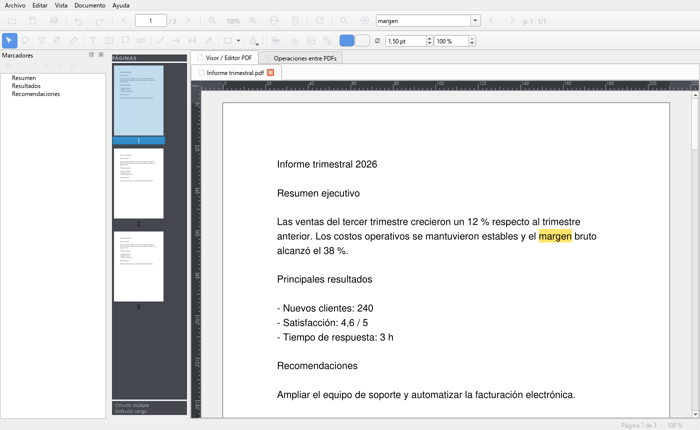

# PDFRapid — editor de PDF libre y sin conexión

[English](README.en.md) · Licencia **AGPL-3.0-or-later** · Windows 10/11 · Python 3.12 + PyQt6 + PyMuPDF

PDFRapid es una alternativa libre a Acrobat y Foxit para ver, anotar, editar, firmar y organizar PDFs.
Funciona **100 % sin conexión**: no envía datos, no tiene telemetría ni IA en la nube. El único uso de red,
opcional y desactivado por defecto, es pedir un sello de tiempo al firmar.



## Funciones

**Ver y leer**
- Pestañas, miniaturas, marcadores editables, enlaces, Atrás/Adelante, pantalla completa, modo nocturno.
- Vista continua, dos páginas o dos páginas con portada; zoom, reglas en mm/cm/pulgadas y guías con ajuste
  («snap») a guías y a objetos; **medir distancia, perímetro y área**, también a escala de plano (1 cm = 1 m).
- **Leer en voz alta** con las voces de Windows, sin conexión (página, hasta el final o selección).
- Organizar objetos: alinear y distribuir, voltear, agrupar, bloquear, ocultar, copiar formato y
  posición y tamaño exactos en milímetros.
- Búsqueda rápida (una coincidencia por pulsación, rápida en documentos de miles de páginas), búsqueda
  avanzada con lista de resultados y **búsqueda en carpeta** con exportación a CSV.

**Anotar y editar**
- Texto, cuadros, comentarios, formas, flechas, lápiz, sellos, resaltado/subrayado/tachado (y quitarlos).
- **Ortografía** al escribir textos y comentarios (corrector de Windows, con sugerencias).
- Editar el texto original del PDF, insertar y recortar imágenes, formato de objetos, deshacer/rehacer.
- **Imágenes del documento**: clic derecho sobre una → convertirla en objeto (mover, tamaño, recortar),
  reemplazarla, guardarla (PNG/JPEG) o eliminarla.
- **Rellenar y firmar** (J): ✓, ✗, punto, línea, fecha de hoy e iniciales con un clic.
- **Formularios**: rellenarlos, crearlos y editarlos (texto, varias líneas, casillas, botones de opción en
  grupo, listas), con nombre, ayuda, valor inicial, obligatorio y solo lectura; vaciar el formulario; **detectar los campos
  automáticamente** (líneas, guiones bajos, casillas y recuadros vacíos).
- Adjuntar archivos, aplanar anotaciones y formularios; crear y editar enlaces.
- Comentarios con respuestas en hilo y estado de revisión (aceptado, rechazado…), visibles también en Acrobat.

**Documento**
- Unir, dividir, mover, extraer, rotar, recortar e insertar páginas (pestaña «Operaciones entre PDFs»).
- Marca de agua, encabezado y pie con texto libre, numeración y Bates, fondo de página, comprimir, proteger con contraseña (AES-256), tachado definitivo
  (redacción), eliminar información oculta, comparar dos versiones.
- **Firma digital** PAdES con certificado (.p12/.pfx), **token USB / tarjeta inteligente** (PKCS#11) o un
  **certificado instalado en Windows**; sello visible con código QR (tamaño a elegir) ubicado con el ratón, sello de
  tiempo opcional (RFC 3161), verificación de firmas y **Lupa QR** para leer el QR de una firma.

**Convertir**
- Crear PDF desde Word, Excel, PowerPoint (con Microsoft Office o LibreOffice; .docx también sin ellos),
  imágenes o escáner (la ventana del fabricante por TWAIN, p. ej. Epson Scan 2, con varias páginas por
  tanda; o el diálogo de Windows por WIA).
- Exportar a Word (.docx), Excel (.xlsx, las tablas), texto, HTML, Markdown (.md), imágenes y **PDF/A-2b** (archivo a largo plazo, validado con veraPDF); **OCR** sin conexión (RapidOCR) para PDFs escaneados.

**Imprimir y procesar**
- Impresión con varias páginas por hoja, folleto, póster, tamaño real y con o sin comentarios.
- **Procesar por lotes** una carpeta: OCR, comprimir, marca de agua, numerar, proteger, PDF/A, aplanar,
  limpiar o exportar a texto/Excel/Markdown (los originales no se tocan).

**General**
- Interfaz en español e inglés, autoguardado con recuperación tras un cierre inesperado,
  instalador y versión portable.
- Ayuda en cada función: botón **?** en cada ventana y panel, **F1** sobre lo que estés usando y Centro de
  ayuda con buscador (Shift+F1). La misma ayuda forma la referencia de funciones de la guía en PDF.

## Descargar

Instalador y versión portable: ver la sección *Releases* del repositorio. Si Windows muestra
«Windows protegió su PC», elige *Más información → Ejecutar de todas formas* (el instalador aún no está
firmado con un certificado de código).

## Ejecutar desde el código

```bash
python -m venv venv
venv\Scripts\pip install -r requirements.txt -r requirements-ocr.txt
venv\Scripts\python main.py
```

Pruebas: `venv\Scripts\pip install -r requirements-dev.txt` y `venv\Scripts\python -m pytest -q`
(se ejecutan sin ventana y sin acceso a la red).

Instalador y portable: `powershell -File packaging\build.ps1` (requiere PyInstaller e Inno Setup 6) →
`build\installer`. El programa compilado se autoverifica con `PDFRapid.exe --selftest`.

## Estructura

| Carpeta | Contenido |
|---|---|
| `core/` | lógica sin interfaz: búsqueda, OCR, firma, conversión, herramientas PDF, ajustes, i18n |
| `ui/` | ventana principal, visor, lienzo de anotaciones (`canvas*.py`), paneles y diálogos |
| `dialogs/`, `models/` | diálogos de formato y modelo de anotación |
| `locales/` | traducción al inglés (`en_ui.json`) |
| `pdfgm_merge.py` | pestaña «Operaciones entre PDFs» |
| `packaging/` | PyInstaller, Inno Setup y avisos de terceros |
| `docs/` | guía de ayuda, política de privacidad, logo |
| `tests/` | pruebas (pytest) |

## Colaborar

Ver [CONTRIBUTING.md](CONTRIBUTING.md).

## Licencia

© 2026 Fernando Erazo. Software libre bajo la **GNU Affero General Public License v3.0 o posterior**
(ver [LICENSE](LICENSE)). Se distribuye **sin ninguna garantía**. Las licencias de los componentes de terceros
están en [packaging/THIRD_PARTY_NOTICES.txt](packaging/THIRD_PARTY_NOTICES.txt).

_Antes se llamó «FlowPDF» y «Pdfgm». Desarrollado con asistencia de Claude (Anthropic)._
